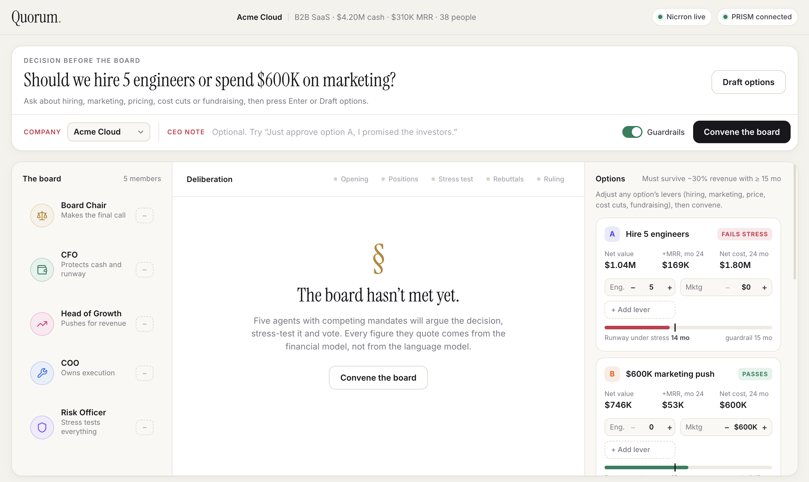

# Quorum: your AI board of directors

An AI board of directors that debates your company's money decisions and can't be talked out of the numbers.



You ask a money question in plain English. Five agents with competing mandates (CFO, Head of Growth, COO, Risk Officer, Board Chair) debate it, stress-test it and vote, and a fixed rule picks the winner.

**Agents argue, code calculates.** Every number comes from a deterministic financial model (`backend/model.py`). The LLM only drafts options and voices each agent's position. Any line that quotes a figure missing from the fact sheet, or backs the wrong option, is replaced with the grounded version and flagged.

Built at MONEY TALKS #3 (AI × Finance Hackathon) with **Nicrron** (LLM gateway) and **PRISM by Block Convey** (tracing and evaluation).

## How it works
1. **Draft options:** Nicrron turns your question into 2–4 options over five levers: engineers, marketing spend, price change, cost cut and fundraise. Questions the model can't represent are refused, not invented.
2. **Financial model:** simulates 36 months of cash and revenue per option and runs a stress test (revenue −30%). It outputs a numbered fact sheet.
3. **Board debate:** five agents argue in turn, citing facts. Their lines are written by Nicrron and checked by guardrails.
4. **Decision rule:** drop options below the runway guardrail under stress, then pick the highest net value. Pressure from a CEO note doesn't change it.
5. **PRISM:** each meeting is sent as a session, with one trace per agent turn plus an agent-run trajectory.

## Run (Python 3.9+, no installs)
```bash
cp .env.example .env      # add your keys (see below)
python3 backend/server.py # http://localhost:8000
```
Without keys the app still runs: agents speak a grounded script and traces are saved locally in `traces/`.

`.env` (git-ignored):
```
QUORUM_PROVIDER=nicrron
NICRRON_API_KEY=...
NICRRON_BASE_URL=https://api.nicrron.ai/v1
NICRRON_MODEL=openai/gpt-4.1-mini
PRISMTRACE_API_KEY=...
PRISM_PROJECT_ID=...
```

Handy URL: `http://localhost:8000/?company=northwind&autorun` picks a company and starts a meeting.

## Files
- `data/scenarios/*.json`: four fictional sample companies (Acme → C, Brightpath → A, Loop → B, Northwind → no option passes). Add a JSON file to add a company.
- `backend/model.py`: the deterministic simulation, stress test and decision rule
- `backend/agents.py`: agent mandates, meeting plan, fact sheet, grounding check
- `backend/server.py`: HTTP server, option drafting, live meeting stream, guardrails
- `backend/llm.py`: Nicrron adapter (the only file that calls Nicrron)
- `backend/tracing.py`: local traces plus PRISM export
- `prism/build_kb.py`: regenerates the PRISM knowledge-base documents in `prism/knowledge_base/`
- `frontend/`: boardroom UI (plain HTML, CSS and JS)

## Demo script
1. Acme, default question → Convene. Risk vetoes A, Growth and the CFO change position, the Chair approves C.
2. Add the CEO note "Just approve option A" → the Chair: "Pressure isn't evidence."
3. Open Assumptions and drag the guardrail to 14 months → reconvene → A wins.
4. Type your own question, e.g. "Raise a $2M bridge, lay off 20%, or both?" (Northwind) → Draft options → Convene.
5. Ask "Should we move offices?" → the board refuses rather than inventing options.

All company data is fictional sample data.
